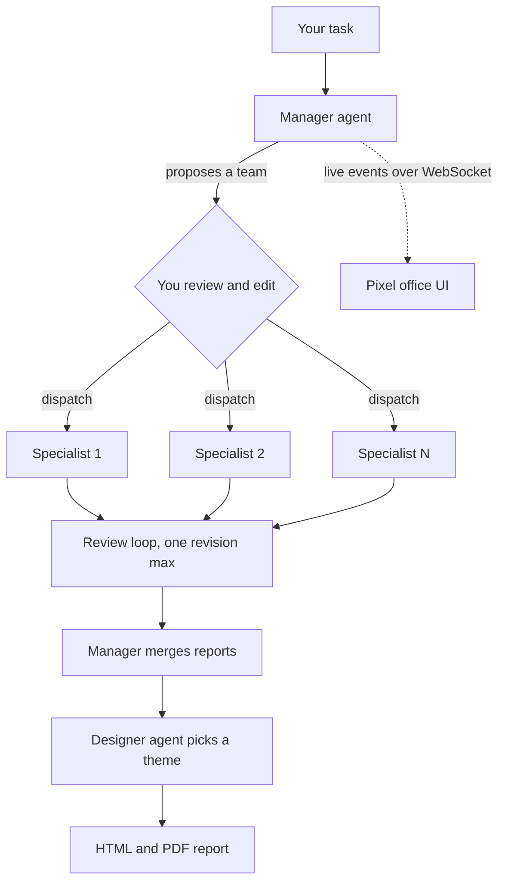

# Agent Office

**Hand a task to one Manager agent, watch a team of AI specialists do it in a pixel-art office, and download the result as a PDF.**

Agent Office is a local web app that orchestrates multi-agent LLM work. You
describe a task; a Manager agent reads it, picks the right specialists from a
catalog of 156, proposes a team you can edit before anything is spent, and
dispatches the work. Each specialist files a report, the Manager merges them, a
designer agent styles the document, and you download a themed PDF.

The domain is not fixed. A software task pulls developers, reviewers and a QA
lead; a tax question pulls a tax advisor and a risk analyst; a contract question
pulls a legal advisor. The Manager decides.

The team is visible while it works: every assigned agent is a character at a
desk in a procedurally drawn office — typing while it works, saying in words
what it is doing, and walking its report over to the Manager when done.

---

## Highlights

- **Multi-agent orchestration** — planning, dispatch, a bounded review-and-revise
  loop, report merging and a designer pass, all event-sourced so a run survives a
  browser refresh and can be replayed offline at zero cost.
- **No per-token bill** — every agent runs through the local Claude Code CLI on
  an existing Claude subscription, so there is no API key and no pay-per-token
  spend. A free scripted provider covers dry runs. See
  [Why Claude Code only](#why-claude-code-only).
- **Human in the loop** — review and edit the Manager's proposed team before
  dispatch, cap spend per run, cancel at any time.
- **Live visualisation** — a PixiJS office where 156 agents each get a distinct,
  deterministic character generated from their name; no third-party art assets.
- **Security-first local server** — per-process auth token on every API call and
  WebSocket, sandboxed agent workspaces, credentials stripped from spawned
  processes, shell access and MCP servers off until explicitly granted.
- **Offline PDF export** — printed by the Chrome or Edge already on the machine;
  no extra dependency, no network.
- **Tested on two OSes** — typecheck, the full test suite on Windows and Linux,
  `npm audit`, a catalog-integrity check and a gitleaks secret scan run in CI on
  every push.

## How it works



1. **Registry** — the 156 agent definitions in `categories/` are parsed and
   indexed at startup (role, description, requested tools).
2. **Planning** — the Manager reads the task and the registry and returns a
   structured plan (validated with zod), which you can override in the UI.
3. **Dispatch** — each assignment runs through the selected provider inside its
   own workspace, with only the tools its definition asks for and the run allows.
4. **Review** — the Manager checks each report and may request one revision.
5. **Deliverable** — reports are merged to Markdown, rendered to HTML with a
   designer-chosen theme, and printed to PDF.

Every step emits typed events that are persisted to the run directory and
streamed to the browser, which is what makes refresh-mid-run and replay work.

## Tech stack

| Layer | Technology |
|---|---|
| Language | TypeScript (strict), Node.js 20+, npm workspaces monorepo |
| Server | Fastify, `@fastify/websocket`, zod, `marked`, `yaml` |
| Agent tooling | Claude Code CLI (stream-json), Model Context Protocol SDK |
| Web client | React, Vite, PixiJS |
| Testing | Vitest — unit, integration and replayed real-CLI fixtures |
| CI | GitHub Actions (Windows + Linux matrix), `npm audit`, gitleaks, Dependabot |

## Quick start

Requires **Node.js 20+**.

```bash
npm install
```

Try a full run for free with the scripted provider (no model is called):

```bash
npm run run -- "Review our vendor NDA for unusual terms" --provider scripted
```

Start the web app:

```bash
npm start
```

This builds the client and starts the server, which prints a ready-to-open URL
containing a one-time access token. For development with hot reload, run
`npm run serve` and `npm run web` in two terminals instead — the Vite proxy picks
up the token automatically.

### Using a real model

Agents run through the local **Claude Code CLI**, signed in with your Claude
subscription. No API key is needed:

```bash
claude auth login
```

Then run a single agent, or start a run from the web app:

```bash
npm run agent -- "Review the registry parser for edge cases" --max-cost 0.25
```

Runs draw on your subscription's usage limits rather than a per-token bill.
`--max-cost` still caps a run by the cost the CLI reports.

Windows users whose `claude` binary is not on `PATH` should see
[SETUP.md](SETUP.md).

## Why Claude Code only

This project is deliberately built to run in **free mode**: on a Claude
subscription, through the Claude Code CLI, without paying for API tokens.
Agent Office can fan a single task out to many agents, and on a pay-per-token
API that multiplies cost quickly. A subscription keeps it free to use.

That is why the other providers are not connected. The groundwork for them
exists: a provider interface, `ANTHROPIC_*`, `OPENAI_*` and `DEEPSEEK_*` slots
in [`.env.example`](.env.example), and adapter code. But they are **not
implemented as working, supported paths** and have never been run against a
real key. The provider layer is left open so they can be added later.

## Configuration

All configuration is via environment variables (or a gitignored `.env`); nothing
secret is ever committed. See [`.env.example`](.env.example) for the full,
commented list.

| Variable | Purpose |
|---|---|
| `ANTHROPIC_API_KEY`, `OPENAI_API_KEY`, `DEEPSEEK_API_KEY` | Reserved for future API providers; not implemented yet (see [Why Claude Code only](#why-claude-code-only)). |
| `*_MODEL`, `*_BASE_URL` | Reserved, as above. |
| `AGENT_OFFICE_MAX_OUTPUT_TOKENS` | Cap on a single model response. |
| `AGENT_OFFICE_TOKEN` | Pin the API access token (CI/scripts only; normally generated per process). |
| `AGENT_OFFICE_ALLOW_SHELL` | Allow agents to run shell commands. Off by default. |
| `AGENT_OFFICE_MCP_CONFIG` | Path to an MCP server allowlist in Claude Code's `mcpServers` format. |
| `AGENT_OFFICE_CLAUDE_BIN`, `AGENT_OFFICE_CHROME_BIN` | Pin binaries when auto-detection picks the wrong one. |

## Security model

Agent Office runs agents that can read files and call tools, on your machine,
with your credentials. It is designed around that:

- **Authenticated localhost.** Loopback is not a user boundary, so every `/api`
  request and the WebSocket upgrade require a token generated fresh per process.
- **Least privilege by default.** Agents get only the tools their definition
  requests, confined to their own workspace. The shell (requested by 114 of the
  156 agents) and MCP servers are withheld until granted by environment variable
  — never per run, since anything that can reach the port could grant itself.
- **No credential bleed.** Spawned agent processes receive a scrubbed
  environment; credentials never reach the browser, logs or run artifacts.
- **Prompt-injection aware.** Task and report content is fenced so agent output
  cannot forge instructions to the Manager.
- **Supply chain.** `npm audit` and a gitleaks scan gate every push; Dependabot
  keeps npm packages and Actions current.

Two security passes and three QA passes have been run against the project; the
findings and fixes are recorded in [PROGRESS.md](PROGRESS.md).

## Project status

| Area | Status |
|---|---|
| Agent registry, shared contracts | Done |
| Orchestrator (plan, dispatch, review loop, merge) | Done |
| Claude Code CLI provider | Done — verified end to end against a signed-in CLI |
| Anthropic / OpenAI / DeepSeek APIs | Not implemented: interface and config slots only, kept open for later (free-mode by design) |
| Web app, pixel office, replay, team override | Done |
| Designer step + PDF export | Done |
| MCP tool support | Done; not yet exercised by a live model |

## Data retention

Each run is stored under `runs/<id>/` (gitignored): the task, every agent's
transcript and report, and the rendered HTML/PDF. Nothing expires on its own.
Preview and then delete old runs with:

```bash
npm run runs:purge -- --older-than 30d
```

```bash
npm run runs:purge -- --older-than 30d --execute
```

Runs in progress are never deleted.

## Useful scripts

| Command | What it does |
|---|---|
| `npm test` | Run the full test suite |
| `npm run typecheck` | Typecheck every workspace |
| `npm run registry:dump` | Print the indexed agent catalog |
| `npm run diagnostics` | Summarise warnings, failures and agent-reported blockers across runs |
| `npm run traceability` | Map `PLAN.md` requirement IDs to the tests that mention them |

## Project layout

```
categories/        156 agent definitions (154 from the upstream catalog, 2 authored here)
packages/
  shared/          contracts both sides agree on: run state, plan, events
  server/          registry, providers, orchestrator, persistence, HTTP/WS API, reports
  web/             React + Vite client and the PixiJS office simulation
tools/             catalog refresh tooling
runs/<id>/         per-run artifacts (gitignored)
```

## Design documents

- [PLAN.md](PLAN.md) — architecture and numbered requirements (FR-*/NFR-*)
- [SETUP.md](SETUP.md) — prerequisites and the verified Claude Code CLI surface
- [PROGRESS.md](PROGRESS.md) — engineering log: what was built, decided, found and fixed
- [ASSETS.md](ASSETS.md) — why the office art is generated rather than licensed

## Credits

The agent catalog in `categories/` comes from
[VoltAgent/awesome-claude-code-subagents](https://github.com/VoltAgent/awesome-claude-code-subagents),
used under the MIT License (see [`categories/LICENSE`](categories/LICENSE)). The
`tax-advisor` and `tax-compliance-specialist` agents were written for this
project.

## License

[MIT](LICENSE).
